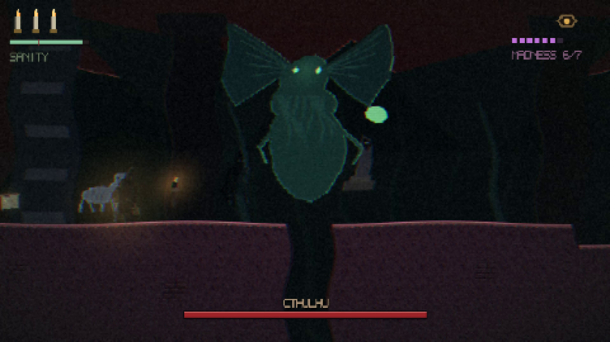

# REGRESO A LA LOCURA — Return to Madness

<p align="center">
  <strong>Cosmic-horror action platformer · pixel art · Godot 4 · 7 stages · 5 languages</strong><br>
  <strong>by DanimanX</strong>
</p>

<p align="center">
  <a href="https://github.com/DanimanX/ReturnToMadness/actions/workflows/build.yml">
    
  </a>
  
  
</p>

<p align="center">
  <a href="promo/return-to-madness-promo.mp4">
    
  </a>
</p>

<p align="center">
  <em>▶ Watch the 1080p promo — <a href="promo/return-to-madness-promo.mp4">English</a> · <a href="promo/regreso-a-la-locura-promo.mp4">Español</a></em>
</p>

<p align="center">
  Regreso a la Locura is free. If it earns a place in your library and you
  feel like saying thanks, you can buy me a coffee — completely optional.
</p>

<p align="center">
  <a href="https://paypal.me/DanimanX?locale.x=en_US&amp;country.x=CL">
    
  </a>
</p>

<p align="center">
  <sub><a href="https://paypal.me/DanimanX?locale.x=en_US&amp;country.x=CL">paypal.me/DanimanX</a></sub>
</p>

---

> *"It was not death that claimed me, but the certainty that I had been here before."*

You are **the Witness**, last acolyte of the Order of the Open Eye, descending through the
seven layers of Cthulhu's dream to seal again the seals that someone is opening from the
inside. Every layer you cross tears away a piece of your sanity, and the madness you
accumulate **never heals**: it makes you hit harder, makes you see horrors that are not
there, and in the end it returns you to the beginning.

**Playtime:** ~20–40 minutes per run · **Saving:** at the altars.

---

## Play it

Grab a build from [Releases](https://github.com/DanimanX/ReturnToMadness/releases):
Linux, Windows and Web. macOS can be exported from the editor with the `macOS` preset
(the CI job is wired up, but the GitHub runner hangs while importing assets).

```bash
# Open the project in Godot 4.7+
godot --path . --editor

# Or play it directly
godot --path .
```

Linux, from the downloaded build:

```bash
unzip regreso-a-la-locura-linux.zip
chmod +x regreso-a-la-locura.x86_64
./regreso-a-la-locura.x86_64
```

| Key | Action |
|-----|--------|
| `A` / `D` or arrows | Move |
| `Space` | Jump (hold for a higher jump) |
| `J` or left click | Strike — 3-hit combo |
| `K` | Dodge (invulnerable, passes through projectiles) |
| `L` | **The Voice**: a scream that stuns and pushes, costs sanity |
| `E` | Interact |
| `Esc` | Pause / controls |
| `Enter` | Confirm |
| `←` `→` | Change language (title screen or pause) |

Gamepads work too (left stick, `A` jump, `X` strike, `B` dodge, `Y` The Voice).

---

## Languages

The game ships in **five languages**: Spanish, English, French, Portuguese and Italian.

Switch with **← →** on the title screen or in the pause menu. The choice is stored in
`user://settings.cfg` and survives between runs; on first launch it tries to match your
system language.

**Everything** is translated: stage names, intros, lore fragments, revelations, boss names,
the whispers of madness, HUD, menus and the ending.

Texts live in `assets/lang/{es,en,fr,pt,it}.json`, generated by `tools/gen_lang.py`,
which refuses to write if any language is missing a string.
`tools/check_lang.py` verifies the same thing in CI.

---

## Promo videos

The videos are generated from the game itself — nothing is edited by hand:

```bash
bash tools/gen_promo.sh                  # Spanish
LANG_CODE=en bash tools/gen_promo.sh     # English (also fr, pt, it)
```

1. Godot records the run at native resolution (480×270, lossless) with `--write-movie`.
2. `tools/gen_promo_audio.py` aligns the soundtrack to the real cut points.
3. `ffmpeg` scales ×4 with nearest-neighbour and encodes H.264 at 1080p.

Output: `promo/return-to-madness-promo.mp4` (English) and
`promo/regreso-a-la-locura-promo.mp4` (Spanish).

---

## The two bars

**Sanity** (0–100, per stage) drops when you take damage, when you stand near horrors and
in the dark. At zero the Witness screams, loses a candle and madness rises. It recovers at
the **altars** (which are also save points) and by killing.

**Madness** (0–7, permanent) rises as you advance, as you kill and as you die. It never
goes down:

- damage you deal: **×(1 + 0.13 · madness)**
- damage you take: **×(1 + 0.09 · madness)**
- enemies notice you sooner, and spectres that are not there begin to appear

| Tide | Name | What changes |
|------|------|--------------|
| 0 | Witness | nothing |
| 1 | First whisper | vignette, whispers |
| 2 | Crack | chromatic aberration, hallucinations |
| 3 | Voice | screen warp, trembling HUD |
| 4 | Vortex | control drift, eyes in the background |
| 5 | Choir | duplicated silhouettes, constant whispers |
| 6 | Sleeper | everything breathes, the eye follows you |
| 7 | Return | the game restarts with a deformed world |

---

## The seven stages

1. **The Drowned Coast** — Innsmouth in the rain · *The Drowned Priest*
2. **The Crypts of Dagon** — flooded catacombs · *The Gilled Mother*
3. **The Forbidden Wing** — Miskatonic Library · *The Librarian*
4. **The Plateau of Leng** — ice and the moon of Kadath · *The Moon Hunter*
5. **The Abyss of Yuggoth** — fungal machine-city · *The Mi-Go Engineer*
6. **The Dream of R'lyeh** — impossible geometry · *The Self I Never Was*
7. **The Throne of the Sleeper** — the dreaming chamber · *Cthulhu*

Each stage has an altar (save point), optional lore fragments and a three-phase guardian
at the end. Behind the door, a revelation.

---

## Project layout

```
project.godot              autoloads: GameState, I18n, AudioDirector
scenes/main.tscn           single root scene; everything else is built in code
data/stages.gd             the 7 stages as ASCII maps (generated, editable)
scripts/
  main.gd                  flow: title, stages, death, revelation, loop
  game_state.gd            madness, sanity, candles, save file
  i18n.gd                  5-language lookup with Spanish fallback
  level.gd                 parses the map, autotiles, collision, props, entities
  player.gd                movement, combo, dodge, The Voice
  enemy.gd                 five creatures with their own behaviour
  boss.gd                  seven guardians, three phases, patterns
  tentacle.gd              tentacle that bursts out and retracts
  hud.gd                   candles, sanity, madness, boss bar, whispers
  madness_fx.gd            post-processing and hallucinations
  pixel_font.gd            5x7 bitmap font drawn from an atlas
  smoke.gd / bot.gd        verification harness (see below)
shaders/madness.gdshader   aberration, warp, vignette, grain, scanlines, tint
assets/                    sprites, tiles, backgrounds, ui, audio (all generated)
assets/lang/               five languages as JSON
tools/                     generators for art, audio, levels, text and video
promo/                     promo videos generated from the game
.github/workflows/build.yml  CI: Linux, Windows, macOS, Web + release
```

### Levels are text

A stage is a 17-row ASCII map in `data/stages.gd`:

```
"...................",   .  empty          P  start          A  altar (save)
"..###.......###....",   #  solid          X  gate           b  lore fragment
"..###..^....###....",   =  platform       B  boss           t  torch
"#########..########",   ^  spikes         s  statue         :  chain
                         ~  water          1 drowned  2 cultist  3 polyp
                                          4 beast    5 Mi-Go    T tentacle
```

Rules the generator enforces: no jump exceeds 4 tiles horizontally or 3 tiles vertically.

---

## Regenerating the content

All content is procedural and reproducible:

```bash
python3 tools/gen_player.py     # the Witness: 28 frames
python3 tools/gen_enemies.py    # 5 creatures + 7 bosses + spectre
python3 tools/gen_world.py      # 6 tile atlases + props
python3 tools/gen_bg.py         # 7 stages × 2 parallax layers
python3 tools/gen_ui.py         # font, candles, eye, logo
python3 tools/gen_audio.py      # 7 ambiences, boss music, 12 effects
python3 tools/gen_lang.py       # the 5 language files
python3 tools/gen_stages.py     # the 7 ASCII maps + validation
```

`gen_stages.py` **validates** every stage: if a jump is impossible or a marker floats, it
fails and writes nothing.

---

## Verification

The project ships with a harness that plays itself. It is not a demo: it is the regression
test.

```bash
# guided screenshots in /tmp/shots (title, stage 1, madness 6, library, Cthulhu)
godot --path . -- --smoke

# can stage N be traversed end to end? (bot that jumps, hits and dodges)
godot --headless --path . -- --smoke --traverse --invuln --stage=1

# does the boss die and the gate close the stage? (duel + full loop)
godot --headless --path . -- --smoke --bosstest --stage=1
```

Measured on this machine (Godot 4.7.2, Linux, no dedicated GPU):

- **Geometry**: all 7 stages are traversable end to end without getting stuck.
  Bot times: 22 s, 27 s, 33 s, 32 s, 66 s, 38 s, 36 s (at ×2.5 speed).
- **Combat**: all 7 guardians die and the gate completes the stage, raising madness from
  0.8 to 7.0 across a full run.
- **Structure**: `gen_stages.py` validates jumps and footholds before writing
  `data/stages.gd`; `check_lang.py` validates all five languages in CI.

The `--invuln` mode exists because the bot is not a combat AI: it isolates geometry from
fights.

---

## Credits

**A game by DanimanX.**

Code, art and audio generated for this project. The Cthulhu mythos belongs to
**H. P. Lovecraft** and is in the public domain; proper names are used as homage.
Inspired by the feel of *Blasphemous* (The Game Kitchen).

No license declared: all rights reserved by the author. If you want it to be free
software, add a `LICENSE` (MIT, GPL-3.0, or CC-BY for the art) — that is the only
publishing decision still open.
